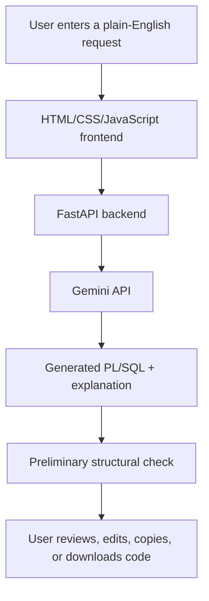

<div align="center">

# ✨ NLSQLAGENT — PL/SQL Studio

### Turn natural-language requests into Oracle PL/SQL code.

A web-based PL/SQL generation studio powered by Gemini, built with **HTML, CSS, JavaScript, and FastAPI**.

<p>
  
  
  
  
  
  <a href="https://nlsqlagent-plsql-studio.onrender.com/"></a>
</p>

**Live Demo:** 🚀 [Open NLSQLAGENT PL/SQL Studio](https://nlsqlagent-plsql-studio.onrender.com/)  
**Source Code:** [GitHub Repository](https://github.com/Shayan-Chakra/NLSQLAGENT-PLSQL-Studio)

</div>

---

## 📚 Table of Contents

- [Overview](#-overview)
- [Features](#-features)
- [Supported PL/SQL patterns](#-supported-plsql-patterns)
- [How it works](#-how-it-works)
- [Quick start](#-quick-start)
- [Configuration](#-configuration)
- [Run locally](#-run-locally)
- [Live demo and deployment](#-live-demo-and-deployment)
- [Example prompts](#-example-prompts)
- [Project structure](#-project-structure)
- [Security and limitations](#-security-and-limitations)
- [Troubleshooting](#-troubleshooting)
- [Roadmap](#-roadmap)
- [Contributing](#-contributing)
- [License](#-license)

## 💡 Overview

NLSQLAGENT — PL/SQL Studio helps users describe a database programming task in plain English and generate a first draft of Oracle PL/SQL code. It provides a browser-based workspace for composing prompts, selecting a code type, reviewing generated code, and copying or downloading the result.

> **Generation only:** this project does not connect to an Oracle database and does not execute generated SQL or PL/SQL. The schema file is contextual metadata, not a live database connection.

## ✨ Features

- **Natural-language generation** through the Gemini API.
- **Responsive workspace** with light/dark appearance options.
- **Program-type selection** for anonymous blocks, procedures, functions, packages, triggers, cursors, exception handling, or auto-detect.
- **Generation preferences** for comments, exception handling, and example usage.
- **Prompt templates** to help get started quickly.
- **Code workspace** with editing, line wrapping, copy, download, clear, and regenerate controls.
- **Explanation and risk label** returned with generated code.
- **Preliminary structural check** with an explicit warning that Oracle compilation has not been performed.
- **Schema reference panel** populated from `schema.py`.
- **No database credentials required.** Only a Gemini API key and an available Gemini model are needed.

## 🧩 Supported PL/SQL patterns

The generator can help draft examples involving:

- Anonymous `DECLARE ... BEGIN ... EXCEPTION ... END;` blocks
- Variables, constants, conditions, loops, records, and collections
- Explicit cursors and cursor `FOR` loops
- Predefined and user-defined exception handling
- Stored procedures and functions
- Package specifications and package bodies
- Triggers and supported user-defined types
- `DBMS_OUTPUT.PUT_LINE` for illustrative output
- SQL statements used inside a PL/SQL unit, where appropriate

The validity of the generated program depends on the target Oracle version, database objects, privileges, and business requirements.

## 🏗️ How it works



## 🚀 Quick start

### Requirements

- Python **3.10 or newer**
- A Gemini API key from [Google AI Studio](https://aistudio.google.com/)
- Internet access for the Gemini API
- Git (optional, for cloning the repository)

No Oracle Database, SQL Developer, Docker, or Oracle driver is required for the generation-only version.

### 1. Get the project

Clone your repository, or download the repository ZIP from GitHub and extract it.

```bash
git clone https://github.com/Shayan-Chakra/NLSQLAGENT-PLSQL-Studio.git
cd NLSQLAGENT-PLSQL-Studio
```

If your repository has a different name or URL, replace the URL and folder name with your own.

### 2. Create a virtual environment

**Windows — Command Prompt:**

```cmd
python -m venv .venv
.venv\Scripts\activate.bat
```

**Windows — PowerShell:**

```powershell
python -m venv .venv
.\.venv\Scripts\Activate.ps1
```

**macOS / Linux:**

```bash
python3 -m venv .venv
source .venv/bin/activate
```

### 3. Install dependencies

```bash
python -m pip install -r requirements.txt
```

### 4. Configure your Gemini API key

Copy the example environment file **only if you do not already have a `.env` file**.

**Windows — Command Prompt:**

```cmd
copy .env.example .env
notepad .env
```

**Windows — PowerShell:**

```powershell
Copy-Item .env.example .env
notepad .env
```

Edit `.env` so it contains your own valid settings:

```dotenv
GEMINI_API_KEY=your_actual_gemini_api_key
GEMINI_MODEL=your_available_gemini_model_id
```

Replace both placeholders with values supported by your Google AI Studio project. Model availability, rate limits, and quotas depend on your account and project. Do not include the literal `models/` prefix unless the provider's current documentation specifically requires it.

> 🔐 **Never commit `.env` or share your API key.** The repository includes `.gitignore` rules to keep local secrets out of Git.

### 5. Start the application

From the project root, run:

```bash
python -m uvicorn backend.main:app --reload
```

Open **http://127.0.0.1:8000** in your browser.

To stop the server, press `Ctrl+C` in the terminal.

## ⚙️ Configuration

| Variable | Required | Description |
|---|---:|---|
| `GEMINI_API_KEY` | Yes | Your Gemini API key; keep it on the backend. |
| `GEMINI_MODEL` | Yes | A model ID available to your Google AI Studio project. |

The backend reads these settings from the local `.env` file during development and from environment variables when deployed. No Oracle configuration is used.

## 🌐 Live demo and deployment

**Try the application:** [https://nlsqlagent-plsql-studio.onrender.com/](https://nlsqlagent-plsql-studio.onrender.com/)

The application is hosted on Render. The live service URL above is the demo entry point; availability depends on the deployment, provider status, and Gemini API quota configured for the service.

### Deployment configuration (Render)

If you maintain or redeploy the application, use the following configuration. Render can run the FastAPI backend and serve the frontend from the same web service.

### Deploy or update on Render

1. Push this project to a GitHub repository.
2. Sign in to [Render](https://render.com/) and connect your GitHub account.
3. Choose **New → Web Service**, then select this repository.
4. Use the repository root as the Root Directory.
5. Set the following commands:

   **Build Command**
   ```bash
   pip install -r requirements.txt
   ```

   **Start Command**
   ```bash
   uvicorn backend.main:app --host 0.0.0.0 --port $PORT
   ```

6. In Render's **Environment** settings, add:
   - `GEMINI_API_KEY` — your secret Gemini API key
   - `GEMINI_MODEL` — a model ID available to your project
7. Deploy and open the public URL Render assigns to the service.
8. Test PL/SQL generation using the prompts below.
9. Confirm the service opens at the Live Demo URL listed at the top of this README. If Render assigns a different URL, update the Live Demo link accordingly.

Use Render's environment-variable settings for secrets; do not add the key to source code, `render.yaml`, or README. Review the hosting provider's current plans and limits before publishing. See the [Render FastAPI deployment guide](https://render.com/docs/deploy-fastapi) and [environment-variable guide](https://render.com/docs/configure-environment-variables).

## 💬 Example prompts

Try prompts such as:

- “Write an anonymous PL/SQL block that prints `Hello World` using `DBMS_OUTPUT.PUT_LINE`.”
- “Create a procedure that accepts an employee ID and displays the employee's salary.”
- “Write a PL/SQL block using a cursor to display employee names.”
- “Create a function that returns the annual salary for a supplied monthly salary.”
- “Show an example of handling `NO_DATA_FOUND` and `TOO_MANY_ROWS`.”
- “Create a package specification and package body for employee lookup helpers.”
- “Write a trigger that records salary changes.”

Examples that reference real tables or columns depend on the metadata in `schema.py`; the metadata does not prove those tables exist in an Oracle database.

## 📁 Project structure

```text
NLSQLAGENT/
├── backend/
│   ├── __init__.py
│   └── main.py          # FastAPI endpoints and Gemini integration
├── frontend/
│   ├── index.html       # Page structure
│   ├── style.css        # Styling and responsive layout
│   └── script.js        # UI interactions and API calls
├── schema.py            # Schema metadata used in the generation prompt
├── requirements.txt     # Python dependencies
├── .env.example         # Safe configuration template (no real secrets)
├── .gitignore           # Excludes secrets and local files
├── LICENSE              # MIT License
└── README.md
```

## 🔒 Security and limitations

- **No Oracle connection or execution:** the app only returns generated code for review.
- **Do not run code blindly:** generated PL/SQL may contain DML, DDL, dynamic SQL, triggers, or calls to routines with side effects.
- **Preliminary check only:** the structural check is not a complete PL/SQL parser and does not replace compiling code in a dedicated test Oracle schema.
- **Review all outputs:** confirm table names, columns, types, privileges, transaction behavior, and business logic before using generated code.
- **Protect the API key:** keep `GEMINI_API_KEY` in `.env` locally or the deployment host's secret/environment settings. Never put it in frontend JavaScript.
- **Protect a public deployment:** consider authentication, rate limiting, request-size limits, and usage monitoring before making the service widely accessible. A public endpoint using your API key may consume your quota.
- **Schema file is documentation:** adding a table to `schema.py` does not create that table in Oracle.

## 🛠️ Troubleshooting

### Missing Gemini API key

Check that `.env` exists in the project root and contains `GEMINI_API_KEY`. Restart Uvicorn after changing environment settings.

### Model unavailable or HTTP 404

Set `GEMINI_MODEL` to a model currently available to your Google AI Studio project. Check the [Gemini model documentation](https://ai.google.dev/gemini-api/docs/models).

### HTTP 429 — quota or rate limit

Check the [Gemini rate-limit documentation](https://ai.google.dev/gemini-api/docs/rate-limits) and your [rate-limit dashboard](https://ai.dev/rate-limit). Wait for quota reset or review another available model or billing option.

### Live demo is slow or temporarily unavailable

The hosted service may need to start after a period of inactivity, or the configured Gemini model may have exhausted its API quota. Check the Render service logs and its configured `GEMINI_MODEL` / `GEMINI_API_KEY` environment variables. Never place API keys in frontend JavaScript or the README.

### The page does not load locally

Make sure the virtual environment is activated, dependencies are installed, and this command is running from the project root:

```bash
python -m uvicorn backend.main:app --reload
```

Then open `http://127.0.0.1:8000`.

## 🗺️ Roadmap

- [x] HTML/CSS/JavaScript interface
- [x] Gemini-powered PL/SQL generation
- [x] Prompt templates and code download
- [x] No database dependency for generation
- [x] Deploy and add a public demo URL
- [ ] Add automated tests for output parsing and structural checks
- [ ] Consider optional Oracle compilation in a separate, isolated test environment

## 🤝 Contributing

Suggestions and pull requests are welcome.

1. Fork the repository.
2. Create a feature branch.
3. Make a focused change and test it locally.
4. Open a pull request describing the change and its validation.

Please do not include `.env` files, API keys, credentials, or personal/production data in issues or pull requests.

## 📄 License

This project is licensed under the **MIT License**. See the [`LICENSE`](LICENSE) file for details.

---

<div align="center">

Made for learning, experimenting, and building better PL/SQL drafts. ✨

</div>
